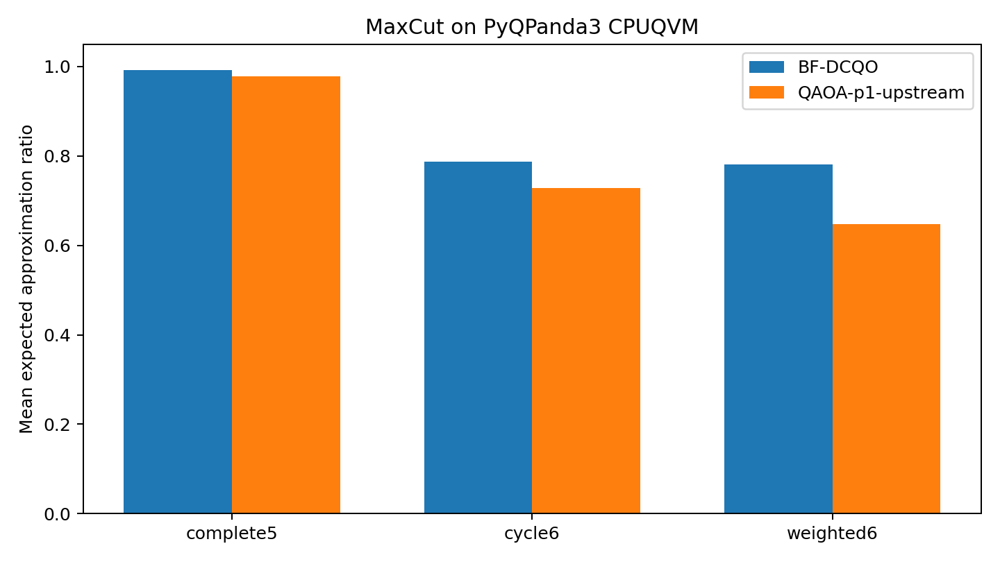
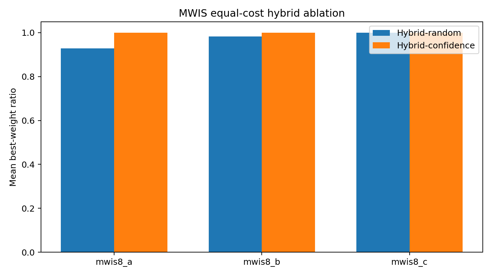

# BF-DCQO CPUQVM 基准报告

本报告由 `scripts/run_bfdcqo_cpuqvm_benchmarks.py` 的 official 配置生成。软件版本为 pyqpanda-algorithm 2.0.0、PyQPanda3 0.3.5、Python 3.13.9；记录的源码 commit 为 `244210a9c0ab38d80f4b3f9bbd686be0682b3b5d`，UTC 时间为 `2026-09-30T10:18:00.659835+00:00`。

## 配置与证据边界

- `maxcut_summary.csv`：3 个实例、3 个初值种子；BF-DCQO 使用 `pyqpanda3.CPUQVM`，QAOA 使用 `pyqpanda_alg.QAOA.CPUQVM`。
- `max3sat_summary.csv`：2 个受控小实例、3 个初值种子；BF-DCQO 使用 `pyqpanda3.CPUQVM`，QAOA 使用 `pyqpanda_alg.QAOA.CPUQVM`。
- `family_summary.csv`：2 个受控问题、预算 [1536, 3072, 6144]、3 个种子；全部使用 `pyqpanda3.CPUQVM`。
- `mwis_summary.csv`：3 个受控 8 顶点实例、3 个初值种子；BF/Hybrid 使用 `pyqpanda3.CPUQVM`，QAOA 使用 `pyqpanda_alg.QAOA.CPUQVM`。
- `initial_parameter_seed` 只控制优化器初值；CPUQVM 的 shot sampling 未由该参数固定。因此结果是可复现配置下的真实采样运行，不应误写成逐 shot 确定性复现。

## 上游 QAOA 预算核算

上游 QAOA 的总 shots 不是按上限推定，而是以 `observed circuit_evaluations × shots` 记录；目标预算按 `(max_evals + 2) × shots` 定义。

- MaxCut：实际 circuit evaluations 24，总 shots 6144，目标预算 6144，delta 0。
- MAX-3-SAT：实际 circuit evaluations 24，总 shots 6144，目标预算 6144，delta 0。
- MWIS：实际 circuit evaluations 6，总 shots 72，目标预算 72，delta 0。

## 结果解读

MAX-3-SAT 的 native HUBO 使用 5 个逻辑量子比特，而 Rosenberg 二次化基线使用 8–9 个量子比特（含 3–4 个辅助变量）。这个量子比特节省伴随更高权重 Pauli 旋转：native 路径的观测最大权重为 3，二次化 QAOA 为 2，所以不能只凭 qubit 数判断总体资源更优。

MWIS 等成本消融中，随机分块 Hybrid 的跨实例平均 best-weight ratio 为 0.970314，置信度引导 Hybrid 为 1.000000。两者量子预算和局部枚举评估次数相同；图表只陈述这批受控实例的观测结果，不外推到其他图族。

所有实例都很小，允许精确求解做校验；种子数也仅为 3。这些数据不构成量子优势证据，也不支持 BF-DCQO 对 QAOA 或其他优化器普遍优越的结论。

## 方法归属

- Basic BF-DCQO 的核心协议归于 A. Gomez Cadavid 等人的 *Bias-field digitized counterdiabatic quantum optimization*（Physical Review Research 7, L022010, 2025；arXiv:2405.13898）。
- native HUBO、CVaR BF-DCQO 与 MAX-3-SAT 构造归于 S. V. Romero 等人的 *Bias-Field Digitized Counterdiabatic Quantum Algorithm for Higher-Order Binary Optimization*（Communications Physics 8, 348, 2025；arXiv:2409.04477）。
- 经典 refinement 的先行概念参见 Hybrid Sequential Quantum Computing（HSQC）；这里的 MWIS 路径是受预算并记录评估次数的工程化消融，并非对 HSQC 的原创性主张。
